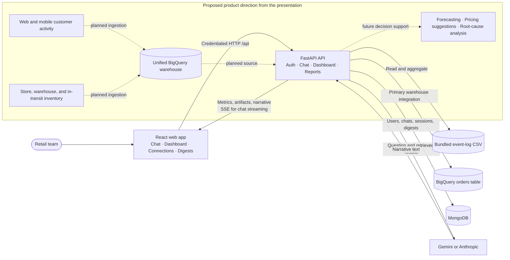
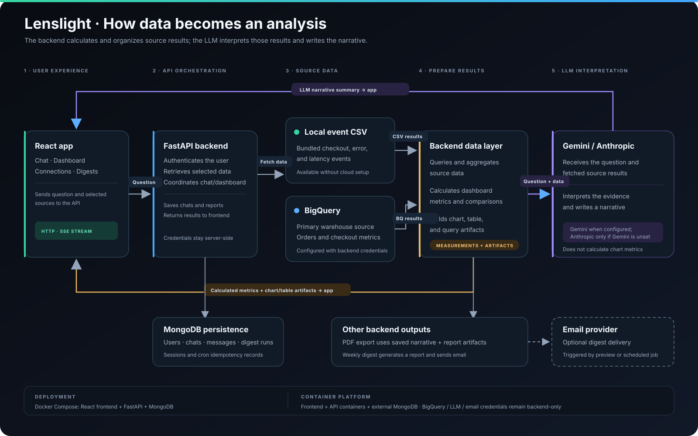

# Lenslight

Lenslight is an AI-driven enterprise commercial intelligence prototype. Its product vision is to bring customer behavior, sales, and omnichannel inventory data together so retail teams can investigate performance and make better operational decisions through conversational AI and dashboards.

The current application is a React frontend backed by a FastAPI API, with BigQuery as its central warehouse integration. The backend queries a configured BigQuery orders table and can analyze the bundled event-log dataset alongside it. The local dataset also makes the prototype usable for demos without a warehouse connection. The deck describes a broader target product; capabilities such as live web/mobile event ingestion, live inventory feeds, forecasting, and dynamic pricing are product direction and are not implemented in this repository yet.

## Current application capabilities

- React interface with login, chat, dashboard, connections, and digest settings.
- FastAPI endpoints for authentication, chat history, streamed responses, dashboards, PDF exports, and digest preferences and dispatch.
- MongoDB persistence for users, chats, messages, sessions, digest activity, and scheduled-task idempotency records.
- Bundled six-month local event-log CSV with checkout, address, latency, and failure data.
- BigQuery warehouse queries for configured order and checkout metrics. BigQuery is the primary enterprise data integration and is configured on the backend; the Connections page does not set it up interactively. The bundled CSV supports local demos and fallback analysis.
- Dashboard comparisons for local events and BigQuery orders over 1–7 days against the preceding equal-length period.
- Gemini narrative generation when configured, with Anthropic used when Gemini is not configured and an Anthropic key is available. Metrics and chart/table artifacts are calculated by the backend and returned separately from the LLM narrative.
- PDF report generation and optional weekly digest emails using the local event data.

## Architecture

The diagram shows what runs today. Dashed nodes describe the deck's proposed future data feeds and decision-support capabilities, not features currently available in the app.



The Mermaid source is [docs/architecture.mmd](docs/architecture.mmd). The detailed architecture image is shown below and available at [docs/architecture.svg](docs/architecture.svg).



### Request and data flow

- The frontend sends credentialed requests to the backend `/api` routes. Chat narrative is streamed using Server-Sent Events (SSE).
- The backend retrieves and aggregates BigQuery warehouse data and bundled local CSV data, then builds chart, table, and query artifacts. The local CSV supports demos and fallback analysis; BigQuery is the primary enterprise source.
- The configured LLM receives the question and retrieved results to write a narrative. It does not calculate dashboard metrics.
- MongoDB stores account and application state. BigQuery, LLM, and email credentials stay in backend configuration.
- Weekly digest work uses the local CSV and an authenticated cron webhook can dispatch digests for subscribed users.

## Product direction in the presentation

The presentation frames Lenslight as an omnichannel retail intelligence system that would unify web and app customer activity with inventory across physical stores, warehouses, distribution centers, and goods in transit. Its proposed decision-support outputs include local demand and stock forecasts, pricing and discount suggestions, and root-cause analysis by store and sales channel. These are intended capabilities, not claims about the current prototype. The current repository has no live customer-event or inventory ingestion pipeline and does not implement forecasting or pricing optimization.

## Runtime shape

The Docker Compose setup runs the React frontend, FastAPI backend, and MongoDB as separate services. For production, the frontend and backend can be deployed as containers on any container platform, with MongoDB hosted externally (for example, MongoDB Atlas). BigQuery, LLM keys, email credentials, and cron secrets belong in the backend's server-side environment or secret store; do not expose them in the frontend.

## Required services
Before deployment, you need:
- MongoDB database (Mongo Atlas or local MongoDB)
- Gemini API key (or an Anthropic API key as an alternative)
- Email API key if weekly digest delivery is enabled
- A frontend origin and backend URL for CORS and deep links

## Local setup

### 1) Create backend environment file
Copy the sample file and fill in your secrets:

cp backend/.env.example backend/.env

Then set real values for:
- MONGO_URL
- DB_NAME
- JWT_SECRET
- GEMINI_API_KEY
- GEMINI_MODEL
- WEBHOOK_CRON_SECRET
- FRONTEND_URL
- DEMO_EMAIL / DEMO_PASSWORD
- EMAIL_API_KEY (optional)

### 2) Create frontend environment file
cp frontend/.env.example frontend/.env

Set:
- REACT_APP_BACKEND_URL=http://localhost:8000

### 3) Install backend dependencies
cd backend
python3 -m venv .venv
source .venv/bin/activate
pip install -r requirements.txt

### 4) Run backend
cd backend
source .venv/bin/activate
uvicorn server:app --host 0.0.0.0 --port 8000 --reload

### 5) Run frontend
cd frontend
npm install
npm start

The UI should open on http://localhost:3000 and the API will be on http://localhost:8000.

## Deployment

The app uses standard Dockerfiles and can run on any platform that supports containers. Deploy the frontend and backend as separate services and use an external MongoDB database for production. The frontend container listens on port `8080`; the backend listens on the platform-provided `PORT` (default `8080`) and exposes its health endpoint at `/api/`.

For local development or a single Docker host, start the complete stack with Docker Compose:

```sh
docker compose up --build
```

For a managed container platform, build from the repository root using each component's Dockerfile and directory as its build context:

```sh
docker build -t lenslight-api ./backend
docker build --build-arg REACT_APP_BACKEND_URL=https://YOUR_BACKEND_URL -t lenslight-web ./frontend
```

Push the images to the platform's container registry and deploy them as separate services. Configure the backend environment and secrets on the backend service. Set the frontend's `REACT_APP_BACKEND_URL` at image build time to the backend's public URL (no trailing slash), because React embeds this value in the built static files.

Chat defaults to both the bundled local dataset and BigQuery. The CSV is at `backend/data/splunk_events.csv`; to replace it, update that file and redeploy the backend. `backend/scripts/generate_splunk_sample.py` regenerates the six-month sample in both that location and `samples/splunk_events.csv`. Weekly digests use the local CSV.

### 1) Deploy the backend

Configure the backend container with:

- Dockerfile: `backend/Dockerfile`
- Build context: `backend`
- Health check path: `/api/`

Add these environment variables in the service settings:

- `MONGO_URL`: MongoDB Atlas connection string
- `DB_NAME`: `lenslight`
- `JWT_SECRET`: long random signing secret
- `GEMINI_API_KEY`: Google AI Studio API key
- `GEMINI_MODEL`: `gemini-2.0-flash`
- `FRONTEND_URL`: leave unset until the frontend is deployed
- `GCP_PROJECT_ID` and `GOOGLE_CLOUD_PROJECT`: Google Cloud project ID
- `BQ_DATASET`: BigQuery dataset name
- `BQ_TABLE`: BigQuery orders table name
- `GOOGLE_APPLICATION_CREDENTIALS`: `/etc/secrets/gcp-service-account.json`

Provide Google credentials through the deployment platform's secure identity or secret mechanism. Do not commit credential files or put them in the frontend. Enable the BigQuery API and grant the service identity **BigQuery Job User** on the project and **BigQuery Data Viewer** on the dataset. On Google Cloud, prefer the runtime service identity over a downloaded service-account key. BigQuery is the primary warehouse integration for Lenslight's enterprise workflows; the bundled local CSV remains available for demos and fallback analysis.

### Append synthetic recent BigQuery orders

For demo data only, the backend includes an append-only script that generates synthetic orders for the configured `BQ_TABLE` (default: `orders`). It uses `GCP_PROJECT_ID` or `GOOGLE_CLOUD_PROJECT`, `BQ_DATASET`, and `BQ_TABLE` from `backend/.env`, and authenticates through Application Default Credentials or `GOOGLE_APPLICATION_CREDENTIALS`.

From the repository root, preview the default seven-day batch first:

```sh
cd backend
./.venv/bin/python scripts/append_bigquery_sample.py --dry-run
```

Then append it:

```sh
./.venv/bin/python scripts/append_bigquery_sample.py
```

Options include `--days 7`, `--orders-per-day 100`, `--seed 20261017`, and `--dry-run`. Rows use deterministic `lenslight-demo-...` IDs, so rerunning with the same options skips IDs that already exist. The service account needs BigQuery Job User and BigQuery Data Editor permissions on the target project/table. These are synthetic demo records, not production transactions. The dashboard queries this configured BigQuery orders table as well as the local CSV and reports each source separately; it does not join records across sources.

Optional backend variables: `WEBHOOK_CRON_SECRET`, `DEMO_EMAIL`, `DEMO_PASSWORD`, `EMAIL_API_KEY`, `EMAIL_FROM_NAME`, and `EMAIL_REPLY_TO`.

### Configure the frontend and service URLs

Build and deploy the frontend container with `REACT_APP_BACKEND_URL` set to the backend's public URL, without a trailing slash. Configure `FRONTEND_URL` on the backend to the frontend's exact origin. These values must match for API requests, CORS, and login cookies. If either URL changes, update the configuration and rebuild/redeploy the frontend as needed.

In MongoDB Atlas, allow connections from the backend service's outbound addresses and use a dedicated database user with a strong password. For browser login, HTTPS is required in production because the backend sets secure cookies for non-local frontend origins. If the frontend and backend use different registrable domains, confirm the browser permits the cross-site authentication cookie; using frontend and API subdomains under the same custom domain avoids many third-party-cookie restrictions.

## Production notes

- Keep `.env` files and credentials out of version control; use the deployment platform's secret manager for sensitive values.
- Chat combines BigQuery warehouse results with local event-log findings. If BigQuery is temporarily unavailable, the report should disclose that and continue with local findings where possible.
- Keep server credentials on the backend; the frontend API URL is a build-time value.
